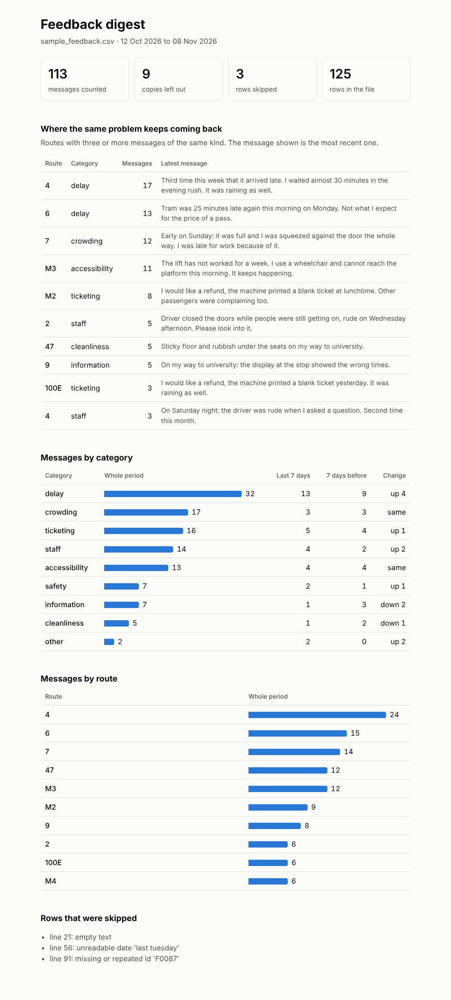

# feedback-digest

Turns a spreadsheet export of passenger feedback into a one-page report.

Reading a few hundred messages every week to find out what people complain about is slow, and the same message sent twice gets counted twice. This script does the reading: it cleans the export, leaves out repeated messages, sorts the rest into categories and shows which routes keep getting the same kind of complaint.



The sample file in `data/` is made up. The route numbers and stop names are from Budapest, but the messages are not real.

## Running it

Needs Python 3.10 or newer. Nothing to install.

```bash
python -m feedback_digest data/sample_feedback.csv
```

```
125 rows read, 3 skipped, 9 copies left out
113 messages counted
Report: output/report.html
```

This writes two files to `output/` (change the folder with `-o`):

- `report.html`, a single file you can open in a browser or email to someone
- `cleaned.csv`, every message with its category and, for copies, the id of the original

## Input

A CSV file with these columns: `id`, `received`, `route`, `stop`, `text`. A `channel` column is optional.

The export does not have to be tidy:

- dates can be `2026-11-03`, `2026.11.03.` or `03/11/2026`
- routes like `Tram 4`, ` 4 ` and `4` are treated as the same route, and `metro 3` becomes `M3`
- rows with no text, an unreadable date or a repeated id are skipped and listed at the bottom of the report with their line number, so nothing disappears silently

## How it works

Each step is one file in `feedback_digest/`.

| Step | File | What happens |
| --- | --- | --- |
| 1 | `load.py` | Reads the CSV and cleans dates, routes and whitespace. |
| 2 | `dedupe.py` | Marks messages that were sent more than once. |
| 3 | `classify.py` | Gives each message a category from keyword lists. |
| 4 | `analyse.py` | Counts by category and route, compares the last two weeks, finds repeat problems. |
| 5 | `report.py` | Fills `templates/report.html` and writes the CSV. |

### Finding copies

Two messages are treated as the same message when they are about the same route, arrived within 3 days of each other, and share at least 75% of their words (Jaccard similarity). Numbers count as words, so "20 minutes late" and "45 minutes late" stay separate.

The same complaint weeks apart is deliberately not a copy. That is a problem that keeps coming back, which is the thing the report is supposed to show.

Comparing every message with every other one would get slow on a big file. Instead, messages are grouped by route and sorted by date, and the comparison stops as soon as two messages are more than 3 days apart. Copies are collected with a small union-find structure, so if A matches B and B matches C, all three end up in one group pointing at the earliest message.

On my laptop, 10,000 random messages take about 0.3 seconds and 50,000 take about 3.5 seconds.

### Categories

`delay`, `crowding`, `cleanliness`, `staff`, `ticketing`, `accessibility`, `information`, `safety`, and `other` when no keyword matches. The category with the most matching words wins.

Only whole words match. An earlier idea was to match the start of a word, but then "pass" also matched "passenger".

## Tests

```bash
pip install pytest
python -m pytest
```

## Limitations

- The keywords are English only.
- Keyword rules do not understand tone. A thank-you message about a helpful driver is counted under `staff` like a complaint would be.
- A copy is only found if the route is the same on both messages.
